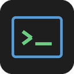

# NetVault + NetMaster + NetMap + NetWatch

   

Программы для сетевого инженера: три работают с одним хранилищем данных,
четвёртая следит за компьютерами домена.

- **NetVault** — где всё записано: серверы, свитчи, роутеры, их адреса,
  модели, стойки, VLAN'ы, заметки и пароли. «Обсидиан + менеджер паролей»
  в одном.
- **NetMaster** — чем всё это управляется: подключение по SSH, терминал,
  массовый прогон команд, файлы по SFTP, пинг и сетевые утилиты. Своей базы
  устройств у него нет — он берёт данные и доступы из хранилища NetVault.
- **NetMap** — как это всё выглядит: карта сети в браузере, кто с кем и каким
  портом соединён. Только просмотр, пароли не читает.
- **NetWatch** — кто из компьютеров домена на связи: берёт список ПК из
  Active Directory, постоянно их проверяет и показывает на веб-странице,
  кто отвечает, кто пропал и у кого сломалась связь с доменом. С хранилищем
  не связан — ставится отдельно, на сервер в домене.

Смысл связки: адрес и пароль вводятся один раз, в NetVault. Дальше
«какой был адрес у core-sw-01» и «под каким логином туда заходить»
больше не вопрос — NetMaster подставляет это сам.

## Как устроено хранилище

Обычная папка на диске, которую видно в проводнике и можно синхронизировать
любым способом (git, облако, флешка):

```
NetVault/
  devices/       по одному .md на устройство: YAML-фронтматтер + свободный текст
  notes/         произвольные заметки и собранные с устройств конфиги
  templates/     шаблоны заметок
  secrets.enc    логины и пароли, AES-256-GCM под мастер-паролем
  .netvault/     настройки и журнал изменений
```

Папку `devices/` можно открыть как vault в Obsidian и писать в заметках
что угодно — приложение читает только фронтматтер, остальной текст не трогает.
Открытый текст — это данные об оборудовании; пароли в заметки не попадают
никогда, они лежат отдельно в `secrets.enc`.

Заметка устройства выглядит так:

```markdown
---
name: core-sw-01
kind: switch
mgmt_ip: 10.0.0.1
vendor: cisco
site: DC1
protocol: ssh
port: 22
tags:
  - core
ports:
  - Gi1/0/1-48
  - Te1/0/49-52
---

Аплинк в ядро, порт Te1/0/52. Меняли БП в марте.
```

## Порты, аплинки и VLAN

Сколько на устройстве портов и как они называются, задаётся во вкладке
**«Данные»**, в разделе «Порты устройства»: тип (Gi, Te, ge- и прочие),
шасси/модуль, количество и номер, с которого начинать. Свитч на 48 гигабитов
и 4 десятки — это две группы, они и лежат в заметке:

```yaml
ports:
  - Gi1/0/1-48     # Gi1/0/1 … Gi1/0/48
  - Te1/0/49-52    # Te1/0/49 … Te1/0/52
```

Дальше вкладка **«Порты (аплинки и VLAN)»** разворачивает группы в таблицу —
строка на порт. Выбрали порт и задали внизу: режим access/trunk, VLAN, соседа
и его порт. Режим и VLAN можно применить сразу к нескольким портам (выделить
мышью с Shift), а аплинк у каждого порта свой — сосед и его порт меняются
только когда выбран один порт. Настроенные порты подсвечены, флажок
«Только настроенные» прячет пустые — на 48 портах это удобнее, чем листать
весь список.

Настройка ложится в те же поля заметки, что и раньше:

```yaml
uplinks:
  - "Te1/0/52 -> balkan-sw-01:Te1/0/49"
vlans:
  - 10                        # VLAN всего устройства, без привязки к порту
  - "Gi1/0/1: access 10"      # порт в access-VLAN 10
  - "Gi1/0/48: trunk 10 20"   # транк с разрешёнными VLAN
```

VLAN внутри записи порта разделяются пробелом: запятая — разделитель элементов
списка, из-за неё строка развалилась бы при чтении. Старые заметки без поля
`ports` открываются как есть — порты, упомянутые в `uplinks` и `vlans`,
всё равно видны в таблице и подсвечены как «не из списка». Если такой порт
появился по опечатке (Te1/1/1 вместо Gi1/1/1), «Проверить хранилище» о нём
скажет.

### Линк настраивается один раз, а не на обеих сторонах

Указали на switch1, что его Gi1/0/1 идёт на switch2:Gi1/0/10, — сохранили,
и на switch2 в его собственной карточке порт Gi1/0/10 сам покажет обратную
запись `Gi1/0/10 -> switch1:Gi1/0/1`. Заходить на switch2 и вписывать то же
самое второй раз не нужно: при каждом сохранении устройства NetVault
сравнивает его аплинки с тем, что было раньше, и по разнице заводит или
убирает обратные записи у соседей. Если снять линк на switch1 — обратная
запись у switch2 тоже уйдёт (но только если она всё ещё указывает именно
на этот линк: чужую пару портов синхронизация не тронет).

Если порт соседа уже занят другим линком — своим или настроенным вручную —
синхронизация его не перезапишет: разбираться в конфликте руками безопаснее,
чем угадывать, кто здесь на самом деле подключён. Аплинки без указания порта
соседа (просто имя устройства) в синхронизации не участвуют — синхронизировать
там нечего.

### Импорт конфигурации

Кнопка **«Импорт конфига…»** (или «Устройство → Импортировать конфиг…»)
разбирает `show running-config` Cisco IOS/IOS-XE и сама заполняет карточку:
имя, IP управления, тип (свитч/роутер), набор портов (сворачивает подряд
идущие интерфейсы в группы вроде `Gi0/0/0-3`), access/trunk и VLAN на каждом
порту. Описания портов вида `description To core-sw-01` пробуёт распознать
как аплинк: если такое устройство уже есть в хранилище — сразу подставляет
его и, если у него самого уже есть обратная ссылка на этот порт (например,
после импорта его собственного конфига), берёт оттуда и порт соседа — линк
получается полностью заполненным без единой ручной правки. Если соседа в
хранилище ещё нет, связь всё равно сохраняется по имени — как только это
устройство появится (в том числе тоже через импорт), порт соседа допишется
сам той же синхронизацией аплинков.

Ничего не сохраняется автоматически — форма только заполняется, дальше можно
поправить руками и нажать «Сохранить» как обычно. Если хостнейм в конфиге уже
есть в хранилище, NetVault спросит: обновить существующую запись сетевыми
данными из конфига (теги, площадка, стойка, ссылка на доступы не трогаются)
или завести отдельной новой.

## Карта сети

Кто с кем и каким портом соединён — видно в браузере. Связи пишутся в заметке
устройства, в поле `uplinks`:

```yaml
uplinks:
  - "Gi1/0/48 -> balkan-sw-01:Gi1/0/1"   # свой порт -> сосед:порт соседа
  - balkan-sw-01                          # можно и просто соседа, без портов
```

Руками это писать не нужно — связи задаются во вкладке «Порты (аплинки и VLAN)»
(см. выше).

Запуск: `python netweb/main.py` (или в NetVault меню «Инструменты → Карта сети
в браузере»). Откроется страница: устройства сгруппированы по регионам из поля
`site`, между ними линии с подписанными портами, клик по устройству показывает
его карточку. Ссылка на несуществующее устройство рисуется красным пунктиром —
сразу видно опечатки в данных.

Карта работает только на просмотр и **не открывает пароли**: файл `secrets.enc`
она не читает вовсе. Сервер слушает только 127.0.0.1 — снаружи к нему не подключиться.

## Мониторинг ПК в домене (NetWatch)

Программа ставится на сервер в домене и постоянно следит за всеми
компьютерами, которые зарегистрированы в Active Directory: кто сейчас на
связи, кто не отвечает, кто пропал, а у кого сломалась связь с доменом.
Картина — на веб-странице, обновляется сама.

| Статус | Что значит |
|---|---|
| **На связи** | компьютер отвечает по сети |
| **Нет связи с доменом** | в сети отвечает, но в домен давно не входил (по умолчанию 45 дней по `lastLogonTimestamp` или по смене пароля учётной записи компьютера). Обычно это сломанное доверие — «Не удалось установить доверительные отношения…»: машина работает, а доменной учёткой на неё не войти |
| **Не отвечает** | не отвечает, но недавно был на связи — выключили на ночь, ушёл в сон |
| **Пропал** | не отвечает дольше 3 дней (настраивается). Пока своих наблюдений нет — при первом запуске — берётся время последнего входа в домен из AD |
| **Отключён в AD** | учётная запись компьютера отключена; такие не проверяются |

**Откуда список.** Из Active Directory через ADSI — то, что есть в любой
Windows в домене: RSAT и модуль ActiveDirectory не нужны, специальные права
тоже — объекты компьютеров читает любая доменная учётная запись (и SYSTEM на
машине в домене). Список перечитывается на каждом проходе: новый компьютер
в AD сам появится на странице, удалённый — исчезнет, и то и другое попадёт
в журнал событий.

**Как проверяется связь.** Одного ping мало — брандмауэр Windows эхо-запросы
по умолчанию режет. Поэтому сначала идёт стук на порты 445 (SMB), 135 (RPC)
и 3389 (RDP); отказ в соединении тоже считается ответом — компьютер включён.
Только если все порты молчат — ping. Одна пропущенная проверка прощается:
«Не отвечает» ставится после двух подряд, чтобы короткий сбой сети не
засыпал журнал ложными событиями. Проверки идут параллельно, так что
тысяча компьютеров проходится за пару минут.

**Журнал и состояние.** Каждая смена статуса — событие в правой колонке
страницы: кто, когда и из какого статуса в какой. Когда компьютер последний
раз отвечал и с какого момента он в текущем статусе, хранится в
`%PROGRAMDATA%\NetWatch\state.json` (на Linux — `~/.netwatch`) и переживает
перезапуск. Кнопка «Скачать CSV» отдаёт таблицу, которая сразу открывается
в Excel.

### Запуск

```bash
python netwatch/main.py                      # страница: http://127.0.0.1:8770/
python netwatch/main.py --host 0.0.0.0       # страница доступна с других ПК
python netwatch/main.py --once               # одна проверка, таблица в консоль
python netwatch/main.py --base "OU=Компьютеры,DC=corp,DC=local"   # только это подразделение
python netwatch/main.py --computers pcs.txt  # список из файла, а не из AD
```

Настройки: `--interval 120` — пауза между проверками в секундах,
`--lost-days 3` — через сколько дней без ответа компьютер «пропал»,
`--stale-days 45` — через сколько дней без входа в домен считать связь
с доменом потерянной, `--port 8770`, `--data ПАПКА` — где хранить состояние.

Файл для `--computers` — по строке на компьютер: имя или «имя адрес»,
строки с `#` пропускаются. Так NetWatch работает и без домена, и на Linux.

По умолчанию страница открыта только на самом сервере. Чтобы смотреть её
со своего ПК — `--host 0.0.0.0` и разрешить порт в брандмауэре:

```
netsh advfirewall firewall add rule name="NetWatch" dir=in action=allow protocol=TCP localport=8770
```

На странице только то, что и так видит любой пользователь домена (имена,
ОС, подразделения, описания) — паролей и учётных данных там нет. Но
авторизации тоже нет, поэтому открывайте порт только для админской сети.

### Чтобы работал постоянно

Запускать при старте сервера через Планировщик заданий — от SYSTEM, без
входа пользователя. В PowerShell от администратора:

```powershell
$action   = New-ScheduledTaskAction -Execute "C:\NetWatch\NetWatch.exe" -Argument "--host 0.0.0.0 --no-browser"
$trigger  = New-ScheduledTaskTrigger -AtStartup
$settings = New-ScheduledTaskSettingsSet -ExecutionTimeLimit 0 -RestartCount 3 -RestartInterval (New-TimeSpan -Minutes 1)
Register-ScheduledTask -TaskName NetWatch -Action $action -Trigger $trigger -Settings $settings -User SYSTEM -RunLevel Highest
Start-ScheduledTask -TaskName NetWatch
```

`-ExecutionTimeLimit 0` обязателен: по умолчанию планировщик сам снимает
задание через 3 дня работы. Остановить — `Stop-ScheduledTask NetWatch`,
убрать совсем — `Unregister-ScheduledTask NetWatch`.

## Шифрование доступов

```
мастер-пароль --Argon2id (или scrypt)--> KEK
KEK --AES-256-GCM--> DEK
DEK --AES-256-GCM--> все секреты
```

Двухуровневая схема нужна, чтобы смена мастер-пароля перешифровывала только
ключ, а не весь файл. Мастер-пароль нигде не хранится и не восстанавливается —
забыл пароль, потерял секреты (инвентарь в `devices/` при этом остаётся).
Хранилище автоматически закрывается после простоя, буфер обмена чистится.

## Готовые программы (без установки Python)

Собранные `NetVault.exe`, `NetMaster.exe`, `NetMap.exe` и `NetWatch.exe` можно скопировать
на любой компьютер с Windows — Python и библиотеки там не нужны.

**Скачать готовую сборку.** На GitHub: вкладка **Actions** → слева
«Сборка программ для Windows» → **Run workflow** → дождаться зелёной галочки →
внизу страницы запуска скачать архив `NetVault-NetMaster-windows`. Внутри все четыре программы.

**Собрать самому** (нужен Python с галочкой «tcl/tk and IDLE»):

```bash
pip install -r requirements.txt
python build.py                 # все программы, каждая одним файлом
python build.py netmaster       # только NetMaster
python build.py --folder        # папкой вместо одного файла — запускается быстрее
```

Готовое лежит в `dist/`. Сборка сама себя проверяет: запускает собранную программу
с ключом `--selftest` и говорит «работает» или «НЕ РАБОТАЕТ». Ту же проверку можно
сделать руками в любой момент: `NetMaster.exe --selftest`.

Программу собирает та система, на которой запущен `build.py`: `.exe` получится
только на Windows. Поэтому на GitHub сборка и идёт на Windows-сервере.

### Что переносить на другой компьютер

Хранилище — отдельная папка, внутрь программы оно не попадает. Чтобы работать
с теми же данными на другой машине, скопируйте туда и папку хранилища
(по умолчанию `Документы\NetVault`), а при первом запуске укажите к ней путь.
Мастер-пароль остаётся вашим — он нигде не хранится.

`NetVault.exe`, `NetMaster.exe` и `NetMap.exe` держите **в одной папке**: кнопка
«Подключиться в NetMaster» и пункт «Открыть NetVault» ищут соседнюю программу
рядом с собой.

## Установка для разработки

```bash
pip install cryptography paramiko argon2-cffi
```

`argon2-cffi` не обязателен: без него используется scrypt. Для графики нужен
tkinter — на Windows он ставится галочкой «tcl/tk and IDLE» в установщике
Python, на Linux `sudo apt install python3-tk`.

## Запуск

```bash
python netvault/main.py     # хранилище: карточки устройств, поиск, пароли
python netmaster/main.py    # управление: терминал, массовые команды, утилиты
python netweb/main.py       # карта сети в браузере (только просмотр)
python netwatch/main.py     # мониторинг ПК в домене
```

Оба приложения помнят последнее открытое хранилище (`~/.netvault/app.json`),
путь можно задать явно: `--vault ПУТЬ` или переменной `NETVAULT_PATH`.

## Консоль

То же самое без графики — удобно для скриптов и по SSH на прыжковом хосте.

```bash
# хранилище
python netvault/cli.py init
python netvault/cli.py add --name core-sw-01 --kind switch --ip 10.0.0.1 \
                           --vendor cisco --site DC1 --tags core,dc1 \
                           --ports "Gi1/0/1-48,Te1/0/49-52"
python netvault/cli.py set-secret core-sw-01 --username admin --password ...
python netvault/cli.py search "10.0.0."
python netvault/cli.py show core-sw-01
python netvault/cli.py export --format csv        # инвентарь без паролей
python netvault/cli.py doctor                     # проверка на ошибки

# управление
python netmaster/cli.py targets --tag core                  # кто попадёт под фильтр
python netmaster/cli.py ping --site DC1
python netmaster/cli.py run --tag core "show version" --save # вывод ляжет в notes/
python netmaster/cli.py run --device core-sw-01 "show run" --enable
```

Мастер-пароль спрашивается интерактивно; для автоматизации его можно передать
переменной `NETVAULT_PASSWORD`.

## Тесты

```bash
python -m unittest discover -s tests
```

Запускать из корня репозитория. Если Python отвечает
`Start directory is not importable: 'tests'` — значит папки `tests` рядом нет:
команда запущена не из корня либо копия репозитория устарела (`git pull`).
Ожидаемый вывод: `Ran 140 tests ... OK`.

## Структура кода

```
netcore/     общее ядро: модель устройства, Markdown-заметки, шифрование, связи
netvault/    приложение-хранилище (GUI + CLI)
netmaster/   приложение-управление (GUI + CLI), читает хранилище через netcore
netweb/      карта сети в браузере (только просмотр, без паролей)
netwatch/    мониторинг компьютеров домена (отдельно от хранилища)
```

Ядро не зависит от GUI, поэтому всё, что умеют приложения, доступно и из
консоли, и из своих скриптов: `from netcore import Vault`.
